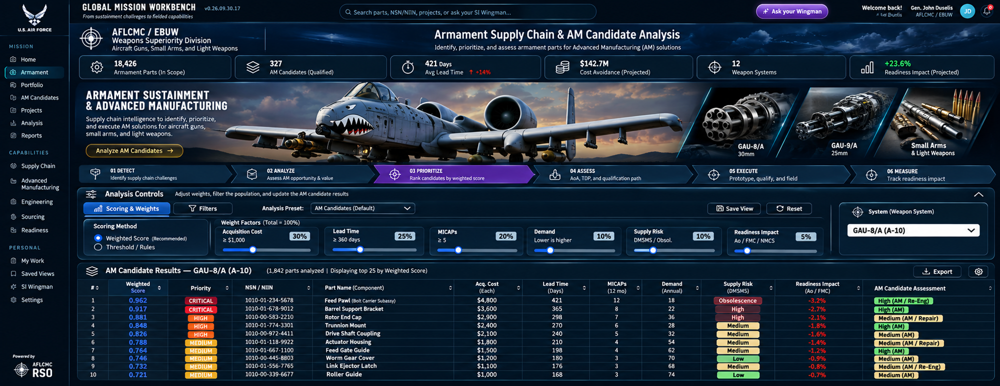

# Armament Supply Chain Analysis



Databricks App for Armament Supply Chain & Advanced Manufacturing (AM) Candidate Analysis.

**Maximize reuse** from [Idea Forge II](https://gitlab.com/drbranton-group/idea-forge-ii):
- Dark navy ops console shell (sidebar, top bar)
- SI Wingman drawer, persona system (Gen. John Duselis / AFLCMC), and Model Serving pattern
- AppKit / Databricks Asset Bundle structure (`databricks.yml`, `app.yaml`)
- Component and data-table patterns

## Concept

The UI is modeled on the Global Mission Workbench Armament Supply Chain & AM Candidate Analysis view (AFLCMC / EBUW). Key elements:

- Dark navy ops console
- KPI strip (Parts in Scope, AM Candidates, Lead Time, Cost Avoidance, Readiness Impact)
- Hero banner with A-10 / GAU-8/A and process pipeline (Detect → Analyze → Prioritize → Assess → Execute → Measure)
- Interactive scoring weights and AM Candidate Results table
- SI Wingman in the top bar

## First Slice

- Sidebar navigation matching Global Mission Workbench Armament view
- KPI strip (Parts in Scope, AM Candidates, Lead Time, Cost Avoidance, etc.)
- Interactive scoring controls with live weight sliders
- AM Candidate Results table with mock GAU-8/A data from the concept UI
- SI Wingman drawer with domain-aware local replies + `/api/wingman` stub (ready for Model Serving)
- Collapsible Hero with full process pipeline

## Data

Mock data in `client/src/lib/data.ts`. Move to Unity Catalog for production.

## Run locally

```bash
npm install
npm run dev
```

## Deploy

```bash
databricks bundle deploy
```

Uses the same workspace host as Idea Forge II. Configure `WINGMAN_ENDPOINT` via app resources for live SI Wingman.

## Next

- Full AppKit server route for `/api/wingman` (copy from Idea Forge)
- Unity Catalog queries for real NSN/parts data
- Brand assets (A-10 imagery — copy `a10.webp` from Idea Forge `communities/`)
- Persist filters / saved views
- Weapon system cards (GAU-8/A, GAU-9/A, Small Arms)
